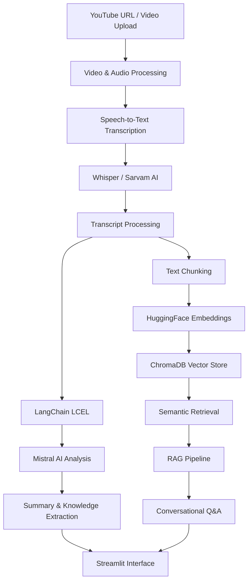

# 🎥 Video Knowledge Retrieval System

### Transform Long-Form Videos into Searchable, Actionable Knowledge

An AI-powered video intelligence platform that converts YouTube videos and multimedia files into searchable knowledge. It uses multilingual speech-to-text transcription, LLM-based analysis, and Retrieval-Augmented Generation (RAG) to help users summarize videos, extract key insights, and ask questions about their content.

---

## 🚀 Overview

Watching long videos to find specific information can be time-consuming. This project solves that problem by transforming video content into structured, searchable knowledge.

Users can upload multimedia files or provide YouTube URLs and interact with their content through an AI-powered conversational interface.

## ✨ Key Features

- **YouTube & Multimedia Ingestion:** Process YouTube URLs and uploaded multimedia files.
- **Multilingual Transcription:** Convert audio into text using OpenAI Whisper and Sarvam AI.
- **AI-Powered Summarization:** Generate concise summaries of long-form video content.
- **Knowledge Extraction:** Automatically identify:
  - Key decisions
  - Important insights
  - Action items
  - Unresolved questions
- **Semantic Search:** Retrieve relevant information using HuggingFace embeddings and ChromaDB.
- **Conversational Q&A:** Ask natural-language questions about video content using RAG.
- **Report Export:** Export generated analysis and insights through the Streamlit interface.

## 🏗️ System Architecture



## 🛠️ Tech Stack

| Component | Technology |
|---|---|
| Programming Language | Python |
| LLM Orchestration | LangChain, LCEL |
| Speech Recognition | OpenAI Whisper |
| Multilingual Transcription | Sarvam AI |
| LLM Inference | Mistral AI |
| Embeddings | HuggingFace |
| Vector Database | ChromaDB |
| Frontend | Streamlit |
| Architecture | Retrieval-Augmented Generation (RAG) |

## ⚙️ How It Works

**1. Video Ingestion**

The system accepts YouTube URLs and multimedia file uploads as input.

**2. Audio Extraction & Transcription**

Audio is processed using Whisper and Sarvam AI to generate multilingual text transcripts.

**3. Content Analysis**

LangChain LCEL orchestrates the analysis pipeline, while Mistral AI generates summaries, identifies key decisions, extracts action items, and highlights unresolved questions.

**4. Document Chunking & Embedding**

Transcripts are divided into smaller chunks and converted into vector embeddings using HuggingFace embedding models.

**5. Vector Storage**

The generated embeddings are stored in ChromaDB for efficient semantic similarity search.

**6. Retrieval-Augmented Generation**

When a user asks a question, relevant transcript chunks are retrieved from ChromaDB and passed to Mistral AI to generate context-aware answers.

**7. Interactive Interface**

Streamlit provides an interface for video ingestion, content analysis, conversational Q&A, and report export.

## 📂 Project Structure

```text
Video-Knowledge-Retrieval-System/
│
├── app.py
├── requirements.txt
├── .env.example
├── .gitignore
│
├── src/
│   ├── ingestion/
│   │   ├── youtube_loader.py
│   │   └── media_loader.py
│   │
│   ├── transcription/
│   │   ├── whisper_transcriber.py
│   │   └── sarvam_transcriber.py
│   │
│   ├── processing/
│   │   ├── chunking.py
│   │   └── embeddings.py
│   │
│   ├── analysis/
│   │   └── content_analyzer.py
│   │
│   ├── retrieval/
│   │   ├── vector_store.py
│   │   └── rag_pipeline.py
│   │
│   └── utils/
│       └── report_export.py
│
├── data/
├── chroma_db/
└── README.md
```

*Note: This is a suggested project organization; adapt it to your actual repository structure.*

## 🔧 Installation & Setup

**1. Clone the repository**

```bash
git clone https://github.com/YOUR_USERNAME/Video-Knowledge-Retrieval-System.git
cd Video-Knowledge-Retrieval-System
```

**2. Create a virtual environment**

```bash
python -m venv venv
```

Activate it:

Windows:
```bash
venv\Scripts\activate
```

Linux / macOS:
```bash
source venv/bin/activate
```

**3. Install dependencies**

```bash
pip install -r requirements.txt
```

**4. Configure environment variables**

Create a `.env` file:

```env
MISTRAL_API_KEY=your_mistral_api_key
SARVAM_API_KEY=your_sarvam_api_key
```

Add any additional API credentials required by your implementation.

**5. Run the application**

```bash
streamlit run app.py
```

Open the local Streamlit URL displayed in your terminal.

## 💡 Example Use Cases

- **Lectures:** Summarize lengthy academic lectures and retrieve specific concepts.
- **Meetings:** Extract decisions, action items, and unresolved discussions.
- **Interviews:** Search long-form interviews for specific topics and insights.
- **Educational Content:** Convert YouTube tutorials into searchable learning material.
- **Research:** Extract useful information from recorded discussions and presentations.

## 🔮 Future Improvements

- Timestamp-aware retrieval to identify exact moments in videos.
- Speaker diarization and speaker-specific queries.
- Multimodal retrieval combining visual frames and audio transcripts.
- Hybrid search combining BM25 and dense vector retrieval.
- Reranking for improved retrieval relevance.
- Conversation history and contextual follow-up questions.
- Evaluation using retrieval precision, recall, and answer faithfulness.

## 🎯 Key Engineering Concepts

This project demonstrates practical implementation of:

- Retrieval-Augmented Generation (RAG)
- Multilingual Speech-to-Text
- Vector Embeddings and Semantic Search
- Vector Database Integration
- LangChain LCEL Pipelines
- Context-Aware Question Answering
- LLM-Based Information Extraction
- End-to-End AI Application Development

---

## 👨‍💻 Author

**Aditya Gupta**

B.Tech – Artificial Intelligence & Data Science

Interested in AI Engineering, LLM Systems, RAG, and Agentic AI.

---

⭐ If you find this project interesting, consider giving the repository a star!
